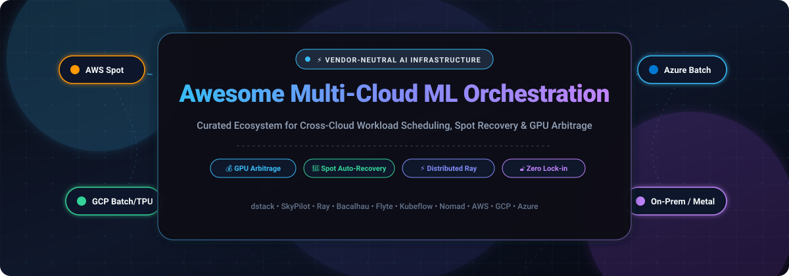

<p align="center">
  
</p>

<p align="center">
  <a href="https://github.com/ishandutta2007/Awesome-Awesome-Awesome"></a>
  <a href="https://discord.gg/jc4xtF58Ve"></a>
  <a href="https://github.com/ishandutta2007/Awesome-Multi-Cloud-ML-Orchestration/stargazers"></a>
  <a href="https://github.com/ishandutta2007/Awesome-Multi-Cloud-ML-Orchestration/network/members"></a>
  <a href="https://github.com/ishandutta2007/Awesome-Multi-Cloud-ML-Orchestration/issues"></a>
  <a href="https://github.com/ishandutta2007/Awesome-Multi-Cloud-ML-Orchestration/blob/main/LICENSE"></a>
  <a href="https://github.com/ishandutta2007/Awesome-Multi-Cloud-ML-Orchestration/pulls"></a>
  <a href="https://github.com/ishandutta2007"></a>
</p>

---

# 🚀 Awesome Multi-Cloud ML Orchestration

> **A curated collection of SaaS platforms, open-source frameworks, schedulers, and tools for vendor-neutral machine learning workload placement, spot recovery, heterogeneous accelerator management, and cross-cloud GPU arbitrage.**

Modern AI engineering demands running training, fine-tuning, batch inference, and data pipelines across heterogeneous infrastructure—**AWS, Google Cloud (GCP), Microsoft Azure, CoreWeave, Lambda Labs, on-premises Kubernetes, Slurm HPC, and bare-metal nodes**—without being locked into any single cloud provider's proprietary ML ecosystem. 

This repository indexes the leading **hosted SaaS platforms** and **open-source orchestrators** that decouple compute definitions from underlying infrastructure providers, automatically arbitrage GPU spot pricing, handle transparent checkpointing and failover, and maximize cluster utilization.

---

## 📑 Table of Contents

- [🌐 Sector Overview & Market Dynamics](#-sector-overview--market-dynamics)
- [💼 SaaS & Hosted Multi-Cloud ML Platforms](#-saas--hosted-multi-cloud-ml-platforms)
- [🛠️ Open-Source Orchestrators & Frameworks](#️-open-source-orchestrators--frameworks)
  - [📊 Open-Source Comparison & Ranking](#-open-source-comparison--ranking)
  - [🔍 Detailed Open-Source Profiles](#-detailed-open-source-profiles)
- [🎯 Architecture & Selection Guide](#-architecture--selection-guide)
- [🤝 How to Contribute](#-how-to-contribute)
- [⚖️ Disclaimer](#️-disclaimer)
- [📈 Star History](#-star-history)
- [💖 Support & Community](#-support--community)

---

## 🌐 Sector Overview & Market Dynamics

The global **AI Orchestration and MLOps sector** is estimated to reach between **$13.6 Billion and $17.2 Billion in 2026**, expanding at a rapid **22% to 42% CAGR** as enterprises shift from isolated experimental models to continuous multi-cloud training, agentic DAGs, and distributed inference architectures.

### 📊 Market Structure & Dynamics:
- **Barbell Market Concentration:** The sector exhibits a **moderately fragmented structure with a polarized barbell distribution**.
- **Foundational Hyperscaler Layer:** At the top tier, major cloud hyperscalers (**Microsoft Azure, AWS, and Google Cloud**) control massive consolidated market share in raw GPU compute, baseline storage, and native batch APIs.
- **Vendor-Neutral & Open-Source Tier:** Simultaneously, rapid cloud price disparities, regional GPU shortages (H100, B200, TPU v5/v6), and high egress fees have catalyzed high fragmentation across open-source schedulers (**Ray, SkyPilot, dstack, Flyte, Bacalhau**). These tools give practitioners leverage through cross-cloud GPU arbitrage, spot interruption protection, and portable declarative infrastructure.

---

## 💼 SaaS & Hosted Multi-Cloud ML Platforms

The following hosted SaaS platforms provide managed multi-cloud orchestration, batch scheduling, and distributed ML control planes. 

The table is **sorted descending by company size (valuation / market capitalization)**:

| 🏢 Platform & Provider | 💰 Valuation / Revenue | 📝 Core Multi-Cloud & ML Capabilities | 🏷️ Specific Starting Price | 🎁 Specific Free Tier / Trial Limit |
| :--- | :--- | :--- | :--- | :--- |
| **[Azure Batch](https://azure.microsoft.com/en-us/products/batch/)** <br>*(Microsoft)* | **~$3.12 Trillion** <br>*(Market Cap)* <br>Cloud Rev: ~$140B+/yr | Cloud-scale job scheduling across CPU and NVIDIA GPU pools; native integration with Azure Blob Storage, Docker containers, and hybrid nodes. | **$0 / month** service fee for the orchestrator <br>*(Pay only for compute: e.g., B1ls VM from **$0.0052/hr**; Spot VMs up to **90% discount**)* | **Free forever** batch control plane with default limit of **100 pools & 100 active jobs**; New accounts receive **$200 credit** (30 days) + **750 hrs** B1S VM for 12 months. |
| **[Google Cloud Batch](https://cloud.google.com/batch)** <br>*(Alphabet / Google)* | **~$2.25 Trillion** <br>*(Market Cap)* <br>Cloud Rev: ~$40B+/yr | Fully managed batch job execution across Compute Engine VMs, spot instances, and TPU v4/v5/NVIDIA GPU hardware with automatic task parallelism and retries. | **$0 / month** service fee for the API <br>*(Pay only for compute: e.g., e2-micro from **$0.0075/hr**; Spot instances from **$0.002/hr**)* | **Free forever** batch management API; New users receive **$300 free trial credits** (valid for 90 days) + **1 e2-micro VM & 5 GB storage/mo** under GCP Always Free tier. |
| **[AWS Batch](https://aws.amazon.com/batch/)** <br>*(Amazon / AWS)* | **~$2.15 Trillion** <br>*(Market Cap)* <br>AWS Rev: ~$105B+/yr | Dynamic provisioning and auto-scaling across EC2, Spot Instances, and Fargate; multi-node parallel computing for distributed deep learning jobs. | **$0 / month** scheduler fee <br>*(Pay only for compute: e.g., EC2 t4g.micro from **$0.0104/hr**; AWS Fargate from **$0.04048/vCPU-hr** + **$0.004445/GB-hr**)* | **Free forever** scheduler with no job submission limits; New accounts receive **750 hours/month** of EC2 t2.micro/t3.micro for 12 months under AWS Free Tier. |
| **[Databricks](https://www.databricks.com/)** <br>*(Databricks)* | **~$43.0 Billion** <br>*(Valuation - Series I)* <br>ARR: ~$2.4B+ | Unified Lakehouse and AI platform running identically across AWS, Azure, and GCP with managed MLflow, distributed Spark, and serverless GPU model serving. | Starts at **$0.07 / DBU** for AI/Model Serving, **$0.15 / DBU** for Data Engineering/Jobs Light, and **$0.40 / DBU** for All-Purpose Interactive Compute. | **14-day free trial** with **$400 in Databricks Unit (DBU) credits**; plus **Databricks Community Edition** (15 GB RAM micro-cluster) is free forever for personal learning. |
| **[Weights & Biases](https://wandb.ai/)** <br>*(W&B)* | **~$1.25 Billion** <br>*(Valuation)* <br>ARR: ~$100M+ | Multi-cloud ML orchestration, launch queues for heterogeneous clusters, experiment tracking, pipeline versioning, and GenAI trace monitoring. | **$60 / user / month** for Pro Tier (self-serve monthly/annual billing for small teams). | **Free forever Personal Tier** including **5 model seats**, **5 GB artifact storage/month**, and **1 GB/month Weave trace ingestion** (200 GB for verified academics). |
| **[Anyscale](https://www.anyscale.com/)** <br>*(Anyscale)* | **~$1.0 Billion** <br>*(Valuation)* <br>Funding: $160M | Fully managed Ray platform by the creators of Ray. Schedules distributed Python, LLM fine-tuning, and inference across multi-cloud clusters and private VPCs. | Starts at **$0.0135 / hr** for CPU instances, **$0.56 / hr** for NVIDIA T4 GPU, **$0.95 / hr** for NVIDIA L4 GPU, and **$4.95 / hr** for NVIDIA A100 GPU. | **$100 in free trial credits** on registration (no credit card required) for distributed compute; up to **$20,000 credit grant** for qualified AI startups. |
| **[ClearML SaaS](https://clear.ml/)** <br>*(ClearML)* | **~$100+ Million** <br>*(Valuation)* <br>Funding: $31M | End-to-end hosted MLOps suite with dynamic agent autoscalers for AWS, GCP, Azure, and on-premises GPU clusters with hyperparameter optimization. | **$15 / user / month** (+ usage) for Pro Tier with multi-cloud auto-scaling and triggers. | **Free forever Community Tier** for up to **3 users** with **100 GB artifact storage**, **1 GB metric events**, and **1,000,000 API calls/month** (unlimited self-hosted). |

---

## 🛠️ Open-Source Orchestrators & Frameworks

Open-source multi-cloud orchestrators allow teams to run AI workloads across heterogeneous cloud providers, local data centers, and specialized GPU clouds (e.g., Nebius, RunPod, Lambda, Crusoe) without vendor lock-in.

### 📊 Open-Source Comparison & Ranking

Below is the curated ranking of open-source projects, **sorted descending by GitHub Stars_Count**. Each badge is dynamically linked to the project's live GitHub stargazers:

| 🏅 Rank | 📦 Project | 🌟 GitHub_Stars_Badge | 📜 License | 🎯 Primary Multi-Cloud ML Focus |
| :---: | :--- | :---: | :---: | :--- |
| **1** | **[Apache Airflow](https://github.com/apache/airflow)** | [](https://github.com/apache/airflow/stargazers) | Apache-2.0 | Programmatic DAG authoring and cross-cloud workflow orchestration across AWS, GCP, and Azure. |
| **2** | **[Ray](https://github.com/ray-project/ray)** | [](https://github.com/ray-project/ray/stargazers) | Apache-2.0 | Distributed AI computing engine for multi-node training (Ray Train), tuning (Ray Tune), and serving (Ray Serve). |
| **3** | **[MLflow](https://github.com/mlflow/mlflow)** | [](https://github.com/mlflow/mlflow/stargazers) | Apache-2.0 | Vendor-neutral ML lifecycle platform with unified tracking, model registry, and deployment to multiple clouds. |
| **4** | **[Argo Workflows](https://github.com/argoproj/argo-workflows)** | [](https://github.com/argoproj/argo-workflows/stargazers) | Apache-2.0 | Kubernetes-native container workflow engine for orchestrating heavy-duty parallel ML steps and pipelines. |
| **5** | **[HashiCorp Nomad](https://github.com/hashicorp/nomad)** | [](https://github.com/hashicorp/nomad/stargazers) | BSL / MPL | Lightweight, single-binary workload scheduler with native GPU/TPU device stanzas across multi-cloud and bare metal. |
| **6** | **[Kubeflow](https://github.com/kubeflow/kubeflow)** | [](https://github.com/kubeflow/kubeflow/stargazers) | Apache-2.0 | Cloud-native MLOps platform on Kubernetes featuring Katib, Kubeflow Pipelines, and Training Operator. |
| **7** | **[SkyPilot](https://github.com/skypilot-org/skypilot)** | [](https://github.com/skypilot-org/skypilot/stargazers) | Apache-2.0 | Cross-cloud GPU cost arbitrage, automatic spot instance failover, and multi-cloud execution CLI. |
| **8** | **[Metaflow](https://github.com/Netflix/metaflow)** | [](https://github.com/Netflix/metaflow/stargazers) | Apache-2.0 | Human-friendly ML framework developed at Netflix to orchestrate code seamlessly across AWS, Azure, and GCP. |
| **9** | **[Flyte](https://github.com/flyteorg/flyte)** | [](https://github.com/flyteorg/flyte/stargazers) | Apache-2.0 | Type-safe, distributed workflow and ML pipeline orchestrator for mission-critical Kubernetes deployments. |
| **10** | **[ClearML](https://github.com/clearml/clearml)** | [](https://github.com/clearml/clearml/stargazers) | Apache-2.0 | Auto-magical CI/CD and agent-based task orchestration that schedules ML jobs across any cloud or local GPU cluster. |
| **11** | **[Volcano](https://github.com/volcano-sh/volcano)** | [](https://github.com/volcano-sh/volcano/stargazers) | Apache-2.0 | CNCF batch scheduling engine on Kubernetes supporting gang-scheduling, fair-share, and GPU-topology awareness. |
| **12** | **[ZenML](https://github.com/zenml-io/zenml)** | [](https://github.com/zenml-io/zenml/stargazers) | Apache-2.0 | Extensible MLOps orchestration layer that decouples pipeline code from stacks across AWS, Azure, GCP, and K8s. |
| **13** | **[Kueue](https://github.com/kubernetes-sigs/kueue)** | [](https://github.com/kubernetes-sigs/kueue/stargazers) | Apache-2.0 | Kubernetes-native job queueing controller managing fair-sharing, quotas, and gang admission for shared GPU fleets. |
| **14** | **[KubeRay](https://github.com/ray-project/kuberay)** | [](https://github.com/ray-project/kuberay/stargazers) | Apache-2.0 | Kubernetes operator for Ray clusters providing lifecycle management, autoscaling, and multi-tenant isolation. |
| **15** | **[dstack](https://github.com/dstackai/dstack)** | [](https://github.com/dstackai/dstack/stargazers) | MPL-2.0 | Unified YAML-driven orchestrator treating multiple clouds and bare-metal nodes as a single interchangeable GPU pool. |
| **16** | **[Bacalhau](https://github.com/bacalhau-project/bacalhau)** | [](https://github.com/bacalhau-project/bacalhau/stargazers) | Apache-2.0 | Distributed compute-over-data orchestrator that routes ML jobs to data locations to eliminate egress transfer costs. |
| **17** | **[ColonyOS](https://github.com/colonyos/colonies)** | [](https://github.com/colonyos/colonies/stargazers) | MIT | Meta-orchestrator linking computing continuums across Kubernetes, Slurm HPC clusters, and edge infrastructure. |

---

### 🔍 Detailed Open-Source Profiles

#### 1. 💨 [Apache Airflow](https://github.com/apache/airflow)
[](https://github.com/apache/airflow/stargazers)
- **Overview:** The de facto industry standard for orchestrating programmatic workflows and ML batch pipelines as Directed Acyclic Graphs (DAGs) in Python.
- **Multi-Cloud Value:** Provides certified multi-cloud providers (Amazon AWS, Google Cloud, Microsoft Azure, Databricks, Snowflake) allowing a single master control plane to trigger jobs, sync checkpoints, and coordinate data transfers across disparate cloud backends.
- **Best For:** Complex enterprise ML and data DAGs requiring deep integration with corporate data warehouses and cross-cloud ETL pipelines.

#### 2. ⚡ [Ray](https://github.com/ray-project/ray)
[](https://github.com/ray-project/ray/stargazers)
- **Overview:** Open-source unified compute framework for scaling AI and Python workloads. Powers foundational libraries including Ray Train, Ray Tune, Ray Serve, and Ray Data.
- **Multi-Cloud Value:** Decouples distributed computing logic from hardware topologies. Ray scripts execute identically on an engineer's laptop, an AWS EKS cluster with Karpenter, a GCP GKE cluster with TPUs, or bare-metal servers.
- **Trade-Off:** Operational overhead—requires a robust provisioning layer (like KubeRay or Anyscale) and attentive tuning of plasma object store memory limits.

#### 3. 🧪 [MLflow](https://github.com/mlflow/mlflow)
[](https://github.com/mlflow/mlflow/stargazers)
- **Overview:** An open-source AI engineering and ML lifecycle platform maintained under the Linux Foundation. Covers experiment tracking, model evaluation, artifact registries, and multi-model deployment.
- **Multi-Cloud Value:** Standardizes the model packaging specification (`MLmodel` flavor) so models trained on one cloud (e.g. AWS S3) can be registered centrally and served anywhere across Azure ML, GCP Vertex AI, Kubernetes, or edge devices.
- **Best For:** Teams wanting vendor-independent experiment logging and reproducible artifacts without locked-in platform formats.

#### 4. ⚓ [Argo Workflows](https://github.com/argoproj/argo-workflows)
[](https://github.com/argoproj/argo-workflows/stargazers)
- **Overview:** CNCF graduated container-native workflow engine designed from the ground up for Kubernetes.
- **Multi-Cloud Value:** Enables declarative, multi-step ML pipeline execution where each task runs in an isolated container pod with fine-grained node selectors, tolerations, and resource quotas across multi-region or hybrid Kubernetes clusters.
- **Best For:** Organizations with Kubernetes-first engineering standards seeking lightweight, reproducible workflow execution without Python daemon overhead.

#### 5. 🏔️ [HashiCorp Nomad](https://github.com/hashicorp/nomad)
[](https://github.com/hashicorp/nomad/stargazers)
- **Overview:** A simple, single-binary flexible workload orchestrator capable of deploying containerized and non-containerized applications at massive scale.
- **Multi-Cloud Value:** Features native `device` block scheduling for NVIDIA GPUs and FPGAs with strict constraints and affinities. Avoids the operational complexity of Kubernetes while scheduling seamlessly across bare metal, AWS, Azure, and GCP.
- **Best For:** Organizations prioritizing operational simplicity and unified orchestration of legacy apps, microservices, and GPU batch jobs side-by-side.

#### 6. 🎛️ [Kubeflow](https://github.com/kubeflow/kubeflow)
[](https://github.com/kubeflow/kubeflow/stargazers)
- **Overview:** The canonical cloud-native machine learning platform for Kubernetes.
- **Multi-Cloud Value:** Includes Kubeflow Pipelines (KFP), Katib (hyperparameter tuning), and the Training Operator (supporting distributed PyTorch, TensorFlow, MPI, and XGBoost). Runs consistently on AWS EKS, GCP GKE, and Azure AKS.
- **Trade-Off:** Heavy operational footprint that typically requires dedicated platform engineering teams to maintain CRDs and istio ingress.

#### 7. 🌌 [SkyPilot](https://github.com/skypilot-org/skypilot)
[](https://github.com/skypilot-org/skypilot/stargazers)
- **Overview:** Specialized framework from UC Berkeley designed to run LLMs, AI agents, and batch ML jobs on any cloud with automatic price arbitrage and spot recovery.
- **Multi-Cloud Value:** Users run `sky launch job.yaml` and SkyPilot automatically inspects real-time pricing and availability across AWS, Azure, GCP, Lambda, RunPod, and FluidStack. If a spot instance is interrupted, SkyPilot recovers the task on another cloud or zone seamlessly.
- **Best For:** Frontier AI teams seeking the fastest, lowest-overhead method to slash cloud GPU spending by up to 70% with automatic arbitrage.

#### 8. 🦊 [Metaflow](https://github.com/Netflix/metaflow)
[](https://github.com/Netflix/metaflow/stargazers)
- **Overview:** Human-centric Python/R framework originally built at Netflix to help data scientists design, execute, and inspect production ML pipelines.
- **Multi-Cloud Value:** Decorators like `@batch`, `@kubernetes`, and `@resources(gpu=4)` allow code developed locally to scale out horizontally on AWS Batch or Kubernetes clusters without changing a single line of application logic.
- **Best For:** Data science teams that want to focus purely on modeling code rather than infrastructure manifests and orchestration mechanics.

#### 9. 🪽 [Flyte](https://github.com/flyteorg/flyte)
[](https://github.com/flyteorg/flyte/stargazers)
- **Overview:** LF AI & Data graduated type-safe workflow orchestration platform born at Lyft, engineered for mission-critical ML and data pipelines.
- **Multi-Cloud Value:** Strongly typed task inputs/outputs guarantee data contracts between pipeline steps. Features built-in memoization, multi-cluster execution, and native integrations with Ray, Spark, and AWS/GCP services.
- **Best For:** Large enterprise ML engineering teams demanding strict reproducibility, type safety, and audited data lineage across clouds.

#### 10. 🧹 [ClearML](https://github.com/clearml/clearml)
[](https://github.com/clearml/clearml/stargazers)
- **Overview:** Open-source platform combining experiment management, data versioning, and an autonomous agent-based orchestration system.
- **Multi-Cloud Value:** `clearml-agent` can be installed on any instance—whether a cloud VM in GCP, an AWS spot instance, or an on-premise workstation—and it turns the node into a pull-based worker that executes jobs from central queues.
- **Best For:** Small to mid-sized teams wanting zero-boilerplate orchestration with integrated artifact tracking and self-hosting options.

#### 11. 🌋 [Volcano](https://github.com/volcano-sh/volcano)
[](https://github.com/volcano-sh/volcano/stargazers)
- **Overview:** CNCF batch scheduling engine tailored for high-performance computing (HPC) and deep learning workloads on Kubernetes.
- **Multi-Cloud Value:** Provides advanced batch scheduling policies essential for distributed ML, such as gang scheduling (all-or-nothing node reservation), fair-share scheduling, and NUMA/GPU topology awareness across heterogeneous clusters.
- **Best For:** Platform teams scaling distributed multi-node PyTorch/Horovod training clusters across multiple Kubernetes providers.

#### 12. 🧘 [ZenML](https://github.com/zenml-io/zenml)
[](https://github.com/zenml-io/zenml/stargazers)
- **Overview:** Extensible, open-source MLOps framework that sits between your data science code and the underlying infrastructure.
- **Multi-Cloud Value:** Enables switching between an AWS stack (S3 + SageMaker/Airflow), a GCP stack (GCS + Vertex AI/Kubeflow), or a local Docker stack with a single CLI command (`zenml stack set`).
- **Best For:** Consultants and engineering teams who need to deliver ML pipelines that run agnostically across diverse client cloud environments.

#### 13. 🚥 [Kueue](https://github.com/kubernetes-sigs/kueue)
[](https://github.com/kubernetes-sigs/kueue/stargazers)
- **Overview:** Kubernetes-native job queueing controller managed by the Kubernetes Special Interest Group (SIG).
- **Multi-Cloud Value:** Operates directly on standard Kubernetes batch objects (`Job`, `RayJob`, `JobSet`). Enforces admission quotas, fair-sharing, and borrowing across different teams sharing expensive GPU resources across multiple cloud clusters.
- **Best For:** ML platform operators suffering from cluster starvation and out-of-memory errors caused by unthrottled GPU job submissions.

#### 14. ☀️ [KubeRay](https://github.com/ray-project/kuberay)
[](https://github.com/kuberay-project/kuberay/stargazers)
- **Overview:** Official Kubernetes operator for deploying, managing, and autoscaling distributed Ray clusters.
- **Multi-Cloud Value:** Provides Custom Resource Definitions (`RayCluster`, `RayJob`, `RayService`) that standardize running Ray across AWS EKS (with Karpenter), GCP GKE, Azure AKS, and on-premises OpenShift.
- **Best For:** Production Kubernetes teams hosting Ray workloads who need declarative GitOps automation.

#### 15. 📦 [dstack](https://github.com/dstackai/dstack)
[](https://github.com/dstackai/dstack/stargazers)
- **Overview:** Vendor-neutral AI compute orchestrator that treats multiple clouds, Kubernetes clusters, and SSH-accessible bare metal as a unified GPU pool.
- **Multi-Cloud Value:** Define tasks, dev environments, and model inference services in simple YAML. `dstack` automatically provisions instances across AWS, GCP, Azure, Lambda, or local GPUs, handles spot recovery, and manages autoscaling.
- **Hardware Agnostic:** Schedules workloads onto NVIDIA GPUs, AMD ROCm GPUs, Google Cloud TPUs, and Tenstorrent hardware.
- **Best For:** AI teams wanting training and serving across clouds without the operational headache of building custom Slurm or Kubernetes stacks.

#### 16. 🧭 [Bacalhau](https://github.com/bacalhau-project/bacalhau)
[](https://github.com/bacalhau-project/bacalhau/stargazers)
- **Overview:** Distributed compute-over-data orchestrator engineered to transform where data processing occurs.
- **Multi-Cloud Value:** Instead of paying massive egress fees to move petabytes of training or telemetry data into a central cloud, Bacalhau dispatches Docker containers and WebAssembly jobs directly to where the data resides across edge, cloud, or on-premises storage.
- **Best For:** Massive datasets (genomics, IoT telemetry, high-resolution imagery) where bandwidth and data gravity are primary bottlenecks.

#### 17. 🐝 [ColonyOS](https://github.com/colonyos/colonies)
[](https://github.com/colonyos/colonies/stargazers)
- **Overview:** Go-based meta-orchestration platform designed for the computing continuum.
- **Multi-Cloud Value:** Sits as a neutral broker above existing schedulers (Kubernetes for cloud, Slurm for HPC, and edge executors). Uses declarative FunctionSpecs, Ed25519-signed zero-trust requests, and pull-based executors to bridge disconnected environments behind firewalls.
- **Best For:** Hybrid academic, government, and enterprise research setups linking supercomputers to public clouds.

---

## 🎯 Architecture & Selection Guide

```
                                  +---------------------------------------+
                                  |   Which Multi-Cloud ML Orchestrator   |
                                  |         Should You Choose?            |
                                  +---------------------------------------+
                                                      |
                  +-----------------------------------+-----------------------------------+
                  |                                                                       |
          [Batch & Price Arbitrage]                                            [Complex Pipelines & DAGs]
                  |                                                                       |
       +----------+----------+                                                 +----------+----------+
       |                     |                                                 |                     |
  (Cheapest GPU        (Declarative YAML,                                  (Kubernetes-         (Python-First
   Across Clouds)       Fleets & Bare Metal)                                Native Stack)       Data Science)
       |                     |                                                 |                     |
  [ SkyPilot ]          [  dstack  ]                                      +----+----+           +----+----+
                                                                          |         |           |         |
                                                                      [ Flyte ] [ Argo ]    [ Metaflow ] [ Airflow ]
```

- **For Immediate GPU Cost Savings:** Choose **[SkyPilot](https://github.com/skypilot-org/skypilot)** to automatically find the cheapest available GPU across clouds and handle automatic spot failover.
- **For Declarative Fleets & Bare-Metal:** Choose **[dstack](https://github.com/dstackai/dstack)** to orchestrate dev environments, tasks, and serving without Kubernetes complexity.
- **For Distributed Python & LLM Training:** Choose **[Ray](https://github.com/ray-project/ray)** paired with **[KubeRay](https://github.com/ray-project/kuberay)** and **[Kueue](https://github.com/kubernetes-sigs/kueue)** for robust multi-tenant GPU job queueing.
- **For Enterprise Pipelines & Strong Typing:** Choose **[Flyte](https://github.com/flyteorg/flyte)** or **[Argo Workflows](https://github.com/argoproj/argo-workflows)** on Kubernetes.
- **For Compute-Over-Data Workloads:** Choose **[Bacalhau](https://github.com/bacalhau-project/bacalhau)** to eliminate cross-cloud data egress fees.

---

## 🤝 How to Contribute

Contributions are warmly welcome! Help make the multi-cloud ML ecosystem more accessible, portable, and transparent:

1. 🍴 **Fork** this repository.
2. 🌿 **Create a branch**: `git checkout -b add/my-orchestration-tool`.
3. 📝 **Add or update entries** in `README.md` following the established table and profile format:
   - Specific pricing and free tier details (no vague placeholders).
   - Factual descriptions and direct documentation links.
   - For open-source repos, include the live Shields.io social Stars_Badge.
4. 🚀 **Submit a Pull Request** with a concise explanation of the addition and relevant benchmark/feature links.

---

## ⚖️ Disclaimer

- This repository is a **community-curated index** maintained for educational, architectural, and benchmarking reference. It is not an official endorsement of any vendor or project.
- Pricing, free tiers, quotas, and feature sets change frequently. Always consult official documentation before committing production workloads.
- Benchmarks and performance metrics are vendor-reported; validate workloads against your target accelerator mix (NVIDIA Hopper/Blackwell, AMD ROCm, Google TPU, Tenstorrent) and cloud providers.
- When orchestrating across clouds, monitor egress networking costs and storage latency carefully.

---

## 📈 Star History

[](https://star-history.dera.page/#ishandutta2007/Awesome-Multi-Cloud-ML-Orchestration&type=date&legend=top-left)

---

## 💖 Support & Community

Thank you for exploring and building with **Awesome Multi-Cloud ML Orchestration**! 

If you find this curated directory helpful for your AI platform engineering, infrastructure decisions, or cost optimization:
- ⭐ **Star this repository** to help others discover it and support continuous updates.
- 🍴 **Fork & Share** with your colleagues, MLOps engineers, and DevOps communities.
- ☕ **Sponsor & Buy a Coffee:** You can support ongoing research, maintenance, and open-source contributions directly via the [GitHub Sponsor Dashboard](https://github.com/sponsors/ishandutta2007).
